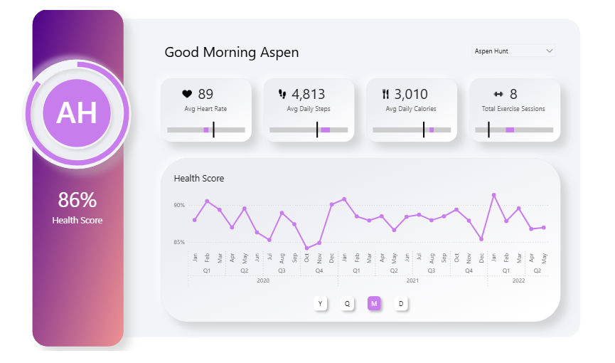

# Fitness Tracker Dashboard (Power BI)

A one-page Power BI report that looks like a mobile app. It shows each user's heart rate, steps, calories and exercise sessions against personal targets, plus a Health Score. Built hands-on by following this video: https://youtu.be/cYwioeHu_OU

## What I learned

### 1. Building the main visualizations
- Use a star-style model: a fact table (`fctFitnessStats`) linked to `dimUser` and `dimDate`.
- Keep all measures in one `Metrics` table, grouped in display folders.
- Build the core visuals: KPI cards, a line chart for the Health Score and a donut ring.

### 2. KPI cards
- Calculate rolling-period KPIs with `CALCULATE` and `DATESBETWEEN`, controlled by one `[Calculation Period]` measure.
- Read each user's targets with `SELECTEDVALUE`.
- Show a value against its target range using a stacked bar made from Min, Range and a fixed fill measure.
- Combine the metrics into a single Health Score from the gap between actual values and target midpoints.

### 3. Dynamic welcome text
- Make a greeting that changes with the time of day and the selected user, using `SWITCH`, `HOUR`, `NOW` and `SELECTEDVALUE`.

### 4. Summary panel with user avatar
- Create an initials avatar (purple circle with white initials, e.g. "AH") from the user's name with a calculated column, and show it in the panel by setting **Data category** to **Image URL**.
- Use a donut chart as a circular progress ring around the avatar.
- Layer visuals with exact size, position and z-order.

### 5. Background and placeholders in PowerPoint
- Design the page background outside Power BI (in PowerPoint) and import it as an image or SVG.
- Leave placeholder shapes in the background where visuals will sit, so everything lines up.

### 6. App-like design
- Use **Neumorphism**: soft shadows and highlights make panels look raised or pressed, like buttons in a mobile app.
- Use rounded cards, a gradient side panel and a light grey background.
- Use custom icons and a consistent colour palette.

### 7. Bookmark navigator for date levels
- Use bookmarks and a bookmark navigator to switch the chart between Year, Quarter, Month and Day.
- Style the navigator buttons so they feel like app controls.

## Dashboard thinking
- Start from what the user wants to see: progress toward their own goals.
- Compare actual values with targets, not raw numbers alone.
- Boil the story down to one headline number (Health Score) and put the detail underneath.
